# ⚗️ Portfólio Profissional · Bruna Pedrosa 👩‍💻

> [!NOTE]
> Portfólio pessoal com identidade visual de **laboratório de química**: a página inicial é uma bancada interativa, o menu é uma **tabela periódica** e cada seção é um "experimento". **Da química ao código: transformando dados em soluções.**

<table>
  <tr>
    <td width="800px">
      <div align="justify">
        Este repositório contém o <b>website de portfólio profissional</b> de Bruna Pedrosa Nunes, desenvolvido como <b>Laboratório 01</b> da disciplina <i>Desenvolvimento e Integração de Aplicações Web (DIAW)</i> do curso de Engenharia de Software da PUC Minas. O site apresenta <i>trajetória</i>, <i>habilidades</i>, <i>projetos</i> e <i>formas de contato</i>, com versão completa em <b>português e inglês</b>, design responsivo, formulário de contato com <b>envio por e-mail (EmailJS)</b> e <b>API própria em Spring Boot</b> que armazena as mensagens em um banco <b>PostgreSQL (Supabase)</b>.
      </div>
    </td>
    <td>
      <div>
        
      </div>
    </td>
  </tr>
</table>

---

## 🚧 Status do Projeto


---

## 📚 Índice

- [Links Úteis](#-links-úteis)
- [Sobre o Projeto](#-sobre-o-projeto)
- [Funcionalidades Principais](#-funcionalidades-principais)
- [Tecnologias Utilizadas](#-tecnologias-utilizadas)
- [Arquitetura](#-arquitetura)
- [Instalação e Execução](#-instalação-e-execução)
  - [Pré-requisitos](#pré-requisitos)
  - [Variáveis de Ambiente](#-variáveis-de-ambiente)
  - [Configuração do EmailJS](#-configuração-do-emailjs)
  - [Banco de Dados (Supabase)](#-banco-de-dados-postgresql-no-supabase)
  - [Instalação de Dependências](#-instalação-de-dependências)
  - [Como Executar a Aplicação](#-como-executar-a-aplicação)
- [Deploy](#-deploy)
- [Estrutura de Pastas](#-estrutura-de-pastas)
- [Demonstração](#-demonstração)
- [Testes](#-testes)
- [Documentações utilizadas](#-documentações-utilizadas)
- [Autores](#-autores)
- [Contribuição](#-contribuição)
- [Agradecimentos](#-agradecimentos)
- [Licença](#-licença)

---

## 🔗 Links Úteis

- 🌐 **Demo Online:** [Acesse o portfólio](https://SEU-PORTFOLIO.vercel.app) <!-- TODO: trocar pelo link da Vercel -->
  > 💻 Front-end publicado na **Vercel**.
- ⚙️ **API:** [Health check da API](https://SUA-API.onrender.com/api/health) <!-- TODO: trocar pelo link do Render -->
  > ☕ Back-end Spring Boot publicado no **Render** (plano gratuito: o primeiro acesso após um tempo parado pode levar alguns segundos).
- 🎨 **Protótipos:** [Wireframes no Figma](https://www.figma.com/) <!-- TODO: trocar pelo link do seu arquivo no Figma -->

---

## 📝 Sobre o Projeto

**Por que existe:** o portfólio reúne, em um só lugar, a trajetória de Bruna, que começou na **Engenharia Química**, passou pela **análise de dados** na Localiza&Co e hoje segue pela **Engenharia de Software**. O site serve para apresentar esse perfil a recrutadores, professores e colegas.

**Qual problema resolve:** currículos em PDF não mostram projetos funcionando. Aqui cada projeto tem descrição, tecnologias, imagens e link para o GitHub, e quem visita pode entrar em contato direto pelo formulário.

**Contexto:** acadêmico. É o **Laboratório 01 (Portfólio Profissional)** da disciplina DIAW, dividido em três sprints (planejamento e protótipo, funcionalidades principais, hospedagem e finalização).

**Identidade visual:** a química é o fio condutor. A página inicial é um laboratório em que cada objeto leva a uma seção:

| Objeto do laboratório                                 | Elemento do menu | Seção                                       |
| :---------------------------------------------------- | :--------------: | :------------------------------------------ |
| 🥼 Jaleco pendurado                                   |    **Sm** (1)    | Sobre mim                                   |
| 🧪 Erlenmeyer e tubos de ensaio (um tubo por projeto) |    **Pj** (2)    | Projetos                                    |
| ⚗️ Coluna de destilação                               |    **Ex** (3)    | Experiências                                |
| 🔥 Bico de Bunsen                                     |    **Ct** (4)    | Contato                                     |
| 🫙 Estante de reagentes                               |    **Fm** (5)    | Favoritos: filmes, séries, livros e músicas |

O logo é o elemento **Br** (bromo, número atômico 35), de **Br**una.

---

## ✨ Funcionalidades Principais

- 🧪 **Página inicial interativa:** laboratório em SVG com objetos clicáveis (também acessíveis pelo teclado) e versão em lista no celular.
- 🧭 **Menu em tabela periódica:** cada seção é um elemento; o da página atual fica destacado.
- 🌐 **Internacionalização (PT/EN):** botão que troca **o site inteiro** entre português e inglês, com a escolha salva no navegador.
- 👩‍🔬 **Sobre mim:** apresentação bilíngue, foto, "ficha técnica" no estilo FISPQ, formação, habilidades em formato de tabela periódica e idiomas.
- 📈 **Projetos em linha do tempo dinâmica:** gerada a partir de um arquivo de dados, do mais antigo para o mais recente, com descrição, tecnologias, link do GitHub e galeria de imagens/GIFs.
- 💼 **Experiências:** cargos como "pratos" de uma coluna de destilação, liderança e desenvolvimento de pessoas (mentoria no College e Facilitadores do Conhecimento) e prêmios/eventos.
- 📨 **Contato:** ícones clicáveis (e-mail, WhatsApp, LinkedIn, GitHub) e formulário com validação que **envia e-mail pelo EmailJS** e **salva a mensagem no banco** pela API.
- 🎬 **Favoritos:** estante de reagentes com filmes, séries e livros (com capas) e músicas com videoclipes do YouTube, que só carregam ao clicar no play.
- 📱 **Design responsivo** e cuidados de acessibilidade (navegação por teclado, textos alternativos, contraste, `prefers-reduced-motion`).

---

## 🛠 Tecnologias Utilizadas

### 💻 Front-end

- **Biblioteca:** React 19
- **Linguagem:** TypeScript 6
- **Build Tool:** Vite 8
- **Rotas:** React Router 7 (`react-router-dom`)
- **Formulários:** React Hook Form 7
- **E-mail:** EmailJS (`@emailjs/browser` 5)
- **Ícones:** React Icons 5
- **Estilização:** CSS puro com variáveis (um arquivo `.css` por componente/página)
- **Gerenciamento de estado:** Context API (idioma) e `useState`
- **Qualidade de código:** Oxlint

### 🖥️ Back-end

- **Linguagem/Runtime:** Java 21 (JDK)
- **Framework:** Spring Boot 3.5 (Web, Data JPA, Validation)
- **Banco de Dados:** PostgreSQL no Supabase (produção) e H2 em memória (desenvolvimento e testes)
- **ORM:** Hibernate / JPA
- **Build:** Maven
- **Testes:** JUnit 5 + MockMvc

### ⚙️ Infraestrutura & DevOps

- **Front-end:** Vercel
- **Back-end:** Render (via Docker)
- **Banco de dados:** Supabase (PostgreSQL como serviço)
- **Containerização:** Docker (imagem do back-end)

### 📦 Dependências

| Parte            | Dependência                                            | Para que serve                                     |
| :--------------- | :----------------------------------------------------- | :------------------------------------------------- |
| Front-end        | `react`, `react-dom`                                   | Construção da interface                            |
| Front-end        | `react-router-dom`                                     | Navegação entre páginas (SPA)                      |
| Front-end        | `react-hook-form`                                      | Estado e validação do formulário de contato        |
| Front-end        | `@emailjs/browser`                                     | Envio de e-mail direto do navegador                |
| Front-end        | `react-icons`                                          | Ícones (Feather, Font Awesome, Lucide)             |
| Front-end (dev)  | `vite`, `@vitejs/plugin-react`, `typescript`, `oxlint` | Build, servidor de desenvolvimento, tipagem e lint |
| Back-end         | `spring-boot-starter-web`                              | API REST                                           |
| Back-end         | `spring-boot-starter-data-jpa`                         | Persistência com JPA/Hibernate                     |
| Back-end         | `spring-boot-starter-validation`                       | Validação dos dados recebidos                      |
| Back-end         | `postgresql`                                           | Driver do banco PostgreSQL (Supabase)              |
| Back-end         | `h2`                                                   | Banco em memória para rodar localmente             |
| Back-end (teste) | `spring-boot-starter-test`                             | JUnit 5, MockMvc                                   |

---

## 🏗 Arquitetura

O sistema segue uma arquitetura **cliente-servidor** com três partes hospedadas separadamente (opção 3 apresentada em aula: React/Vite na Vercel + Spring Boot no Render + banco de dados):

- **Front-end (SPA em React):** todo o conteúdo do portfólio fica em arquivos de dados tipados (`src/data`), o que torna a linha do tempo e as listas **dinâmicas** sem depender do servidor. Assim o site abre rápido mesmo quando a API está "dormindo".
- **Back-end (API REST em Spring Boot):** responsável pelo formulário de contato. Recebe, valida e grava as mensagens. Organizado em camadas: `controller` → `service` → `repository` → `model`, com **DTOs** (`record`) para entrada e saída.
- **Banco de dados (PostgreSQL no Supabase):** tabela `contatos`, criada automaticamente pelo Hibernate.

**Fluxo do formulário de contato:**

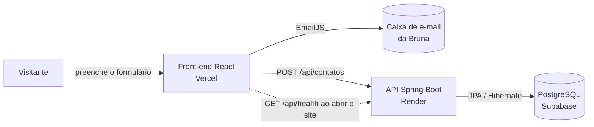

**Decisões e trade-offs:**

- O envio é feito pelos **dois caminhos ao mesmo tempo** (EmailJS e API). Basta um funcionar para a mensagem chegar, então o formulário continua funcionando mesmo se o Render estiver acordando.
- No plano gratuito, o Render desliga o servidor sem acessos. Por isso o front chama `GET /api/health` assim que o site abre, para "acordar" a API antes de a pessoa chegar ao formulário.
- O conteúdo fica no front-end (e não no banco) porque muda pouco e precisa estar sempre disponível. Para adicionar um projeto, basta editar `frontend/src/data/projetos.ts`.
- Os textos ficam separados por idioma (`src/i18n/traducoes.ts` e campos `{ pt, en }` nos dados), sem biblioteca externa.

**Endpoints da API:**

| Método | Rota            | Descrição                                                         |
| :----: | :-------------- | :---------------------------------------------------------------- |
| `GET`  | `/api/health`   | Verifica se a API está no ar                                      |
| `POST` | `/api/contatos` | Salva uma mensagem do formulário (valida nome, e-mail e mensagem) |
| `GET`  | `/api/contatos` | Lista as mensagens recebidas (exige o cabeçalho `X-Admin-Key`)    |

---

## 🔧 Instalação e Execução

### Pré-requisitos

- **Node.js:** 20.19+ ou 22.12+ (exigência do Vite 8) e **npm**
- **Java JDK:** versão **21**
- **Maven:** 3.9 ou superior
- Conta gratuita no **EmailJS**, no **Supabase**, na **Vercel** e no **Render** (só para o deploy)

---

### 🔑 Variáveis de Ambiente

#### 1 Back-end (Spring Boot)

Sem nenhuma variável, a API roda localmente com banco **H2 em memória**. Para usar o Supabase, configure (modelo em [`backend/.env.example`](backend/.env.example)):

| Variável                     | Descrição                                                         | Exemplo                                                                               |
| :--------------------------- | :---------------------------------------------------------------- | :------------------------------------------------------------------------------------ |
| `PORT`                       | Porta da API (o Render define sozinho)                            | `8080`                                                                                |
| `SPRING_DATASOURCE_URL`      | URL JDBC do PostgreSQL (Supabase, "Session pooler")               | `jdbc:postgresql://aws-0-sa-east-1.pooler.supabase.com:5432/postgres?sslmode=require` |
| `SPRING_DATASOURCE_USERNAME` | Usuário do banco                                                  | `postgres.seu_project_ref`                                                            |
| `SPRING_DATASOURCE_PASSWORD` | Senha do banco                                                    | `sua_senha`                                                                           |
| `CORS_ALLOWED_ORIGINS`       | Endereços do front que podem chamar a API (separados por vírgula) | `https://seu-portfolio.vercel.app,http://localhost:5173`                              |
| `ADMIN_KEY`                  | Chave para listar as mensagens (`GET /api/contatos`)              | `uma-chave-longa-e-secreta`                                                           |

#### 2 Front-end (React, Vite)

Copie [`frontend/.env.example`](frontend/.env.example) para **`frontend/.env.local`** e preencha:

| Variável                              | Descrição                                         | Exemplo                     |
| :------------------------------------ | :------------------------------------------------ | :-------------------------- |
| `VITE_API_URL`                        | URL base da API Spring Boot                       | `http://localhost:8080/api` |
| `VITE_EMAILJS_SERVICE_ID`             | ID do serviço de e-mail no EmailJS                | `service_xxxxxxx`           |
| `VITE_EMAILJS_TEMPLATE_ID_FOR_ME`     | Template do e-mail que chega para a Bruna         | `template_xxxxxxx`          |
| `VITE_EMAILJS_TEMPLATE_ID_FOR_SENDER` | (Opcional) Resposta automática para quem escreveu | `template_yyyyyyy`          |
| `VITE_EMAILJS_PUBLIC_KEY`             | Public Key da conta EmailJS                       | `sua_public_key`            |

> **Obs:** variáveis em projetos **Vite** precisam começar com `VITE_` para ficarem disponíveis no código do navegador. Por isso, **nunca** coloque senhas nelas. A Public Key do EmailJS foi feita para ficar pública.

Na **Vercel**, cadastre as mesmas variáveis em _Project Settings › Environment Variables_ e faça um novo deploy.

---

### 📧 Configuração do EmailJS

1. Crie uma conta em [emailjs.com](https://www.emailjs.com/) e, em **Email Services**, conecte seu Gmail. Copie o **Service ID**.
2. Em **Email Templates**, crie o template que chega para você. Use as variáveis `{{name}}`, `{{email}}`, `{{message}}`, `{{title}}` e `{{time}}`. Em _Reply To_, coloque `{{email}}`. Copie o **Template ID**.
3. (Opcional) Crie um segundo template de resposta automática com _To Email_ = `{{email}}`.
4. Em **Account › General**, copie a **Public Key**.
5. Coloque os valores no `.env.local` (local) e na Vercel (produção).

### 💾 Banco de Dados (PostgreSQL no Supabase)

1. Crie um projeto gratuito em [supabase.com](https://supabase.com/) e guarde a senha do banco.
2. Clique em **Connect** e copie a string de conexão do **Session pooler** (funciona em redes IPv4, como a do Render).
3. Monte a URL JDBC no formato `jdbc:postgresql://HOST:5432/postgres?sslmode=require` e use o usuário `postgres.SEU_PROJECT_REF`.
4. Não é preciso criar tabelas: o Hibernate cria a tabela `contatos` na primeira execução (`ddl-auto=update`).

---

### 📦 Instalação de Dependências

1. **Clone o repositório:**

```bash
git clone https://github.com/brunapedrosabr/<nome-do-repositorio>.git
cd <nome-do-repositorio>
```

2. **Front-end:**

```bash
cd frontend
npm install
cd ..
```

3. **Back-end:**

```bash
cd backend
mvn clean install
cd ..
```

---

### ⚡ Como Executar a Aplicação

Execute em **dois terminais**.

#### Terminal 1: Back-end (Spring Boot)

```bash
cd backend
mvn spring-boot:run
```

🚀 _A API estará em **http://localhost:8080** (teste em http://localhost:8080/api/health)._

#### Terminal 2: Front-end (React, Vite)

```bash
cd frontend
npm run dev
```

🎨 _O site estará em **http://localhost:5173**._

> 💡 O front-end funciona sozinho, sem o back-end. Sem `VITE_API_URL` e sem EmailJS configurados, o formulário mostra um aviso com o e-mail para contato direto.

---

## 🚀 Deploy

### Front-end na Vercel

1. Em [vercel.com](https://vercel.com/), clique em **Add New › Project** e importe este repositório.
2. Em **Root Directory**, escolha `frontend`. O preset **Vite** é detectado automaticamente (build `npm run build`, saída `dist`).
3. Cadastre as variáveis `VITE_*` e clique em **Deploy**.
4. O arquivo [`frontend/vercel.json`](frontend/vercel.json) redireciona todas as rotas para o `index.html`, para que links como `/projetos` funcionem ao recarregar a página.

### Back-end no Render

1. Em [render.com](https://render.com/), clique em **New › Web Service** e conecte o repositório.
2. Configure **Root Directory** = `backend` e **Runtime/Language** = **Docker** (o Render usa o [`backend/Dockerfile`](backend/Dockerfile)).
3. Escolha o plano **Free** e cadastre as variáveis do back-end (Supabase, `CORS_ALLOWED_ORIGINS` com a URL da Vercel e `ADMIN_KEY`).
4. Em **Health Check Path**, use `/api/health`.
5. Depois do deploy, copie a URL (ex.: `https://portfolio-api.onrender.com`) e use `https://portfolio-api.onrender.com/api` como `VITE_API_URL` na Vercel.

### Build manual

```bash
# Front-end: gera a pasta frontend/dist
cd frontend && npm run build

# Back-end: gera o .jar em backend/target
cd ../backend && mvn clean package
java -jar target/portfolio-api-1.0.0.jar
```

---

## 📂 Estrutura de Pastas

```
.
├── README.md                      # 📘 Documentação principal (este arquivo)
├── LICENSE                        # ⚖️ Licença MIT
├── .gitignore                     # 🧹 Ignora node_modules, dist, target, .env…
├── docs/
│   └── screenshots/               # 🖼️ Imagens usadas neste README
│
├── frontend/                      # 📁 Aplicação React + Vite + TypeScript
│   ├── .env.example               # 🧩 Modelo das variáveis do front-end
│   ├── vercel.json                # ☁️ Rotas da SPA na Vercel
│   ├── index.html                 # 📄 HTML base (fontes, metadados)
│   ├── package.json               # 📦 Dependências e scripts
│   ├── public/
│   │   ├── favicon.svg            # 🧪 Logo "Br 35"
│   │   ├── bruna.webp             # 👩 Foto da página Sobre mim
│   │   ├── curriculo-bruna-pedrosa.pdf
│   │   ├── favoritos/             # 🎬 Capas de filmes, séries e livros
│   │   └── projetos/              # 🖼️ Telas dos projetos
│   └── src/
│       ├── main.tsx               # 🚀 Ponto de entrada (Router + Provider de idioma)
│       ├── App.tsx                # 🧭 Definição das rotas
│       ├── components/            # 🧱 Componentes reutilizáveis
│       │   ├── ElementTile/       #    Quadradinho de elemento químico
│       │   ├── Lab/               #    Laboratório da página inicial (SVG + lista)
│       │   ├── Layout/            #    Cabeçalho, menu periódico, idioma e rodapé
│       │   ├── PageHeading/       #    Cabeçalho das páginas internas
│       │   └── SocialLinks/       #    Ícones das redes
│       ├── pages/                 # 📄 Páginas (uma pasta por rota, com seu CSS)
│       │   ├── Home/  Sobre/  Projetos/  Experiencias/
│       │   └── Contato/  Favoritos/ (com VideoClipe.tsx)  NaoEncontrada/
│       ├── data/                  # 🗂️ Conteúdo do portfólio (bilíngue)
│       │   ├── perfil.ts  elementos.ts  sobre.ts
│       │   └── projetos.ts  experiencias.ts  favoritos.ts
│       ├── i18n/                  # 🌎 Traduções e contexto de idioma
│       ├── services/              # 🔌 EmailJS, chamadas à API e envio do contato
│       ├── hooks/                 # 🎣 Hooks (título da página)
│       └── styles/global.css      # 🎨 Cores, fontes e estilos globais
│
└── backend/                       # 📁 API Spring Boot
    ├── .env.example               # 🧩 Modelo das variáveis do back-end
    ├── Dockerfile                 # 🐳 Imagem usada no Render
    ├── pom.xml                    # 🛠️ Dependências (Maven)
    └── src/
        ├── main/java/br/com/brunapedrosa/portfolio/
        │   ├── PortfolioApiApplication.java
        │   ├── controller/        # 🎮 ContatoController, HealthController
        │   ├── service/           # ⚙️ ContatoService
        │   ├── repository/        # 🗄️ ContatoRepository (JPA)
        │   ├── model/             # 🧬 Entidade Contato
        │   ├── dto/               # ✉️ ContatoRequest, ContatoResponse
        │   ├── config/            # 🔧 CorsConfig
        │   └── exception/         # 💥 GlobalExceptionHandler
        ├── main/resources/
        │   └── application.properties
        └── test/java/…/ContatoControllerTest.java   # 🧪 Testes da API
```

---

## 🎥 Demonstração

### 🎨 Protótipos (Figma)

<!-- TODO (Sprint 01): exporte os wireframes do Figma para docs/prototipos/ e troque os links abaixo. -->

|        Página Inicial         |             Projetos              |
| :---------------------------: | :-------------------------------: |
| _Wireframe da página inicial_ | _Wireframe da página de projetos_ |

### 🌐 Aplicação Web

|                                                    Página Inicial                                                     |                                                Laboratório                                                |
| :-------------------------------------------------------------------------------------------------------------------: | :-------------------------------------------------------------------------------------------------------: |
|      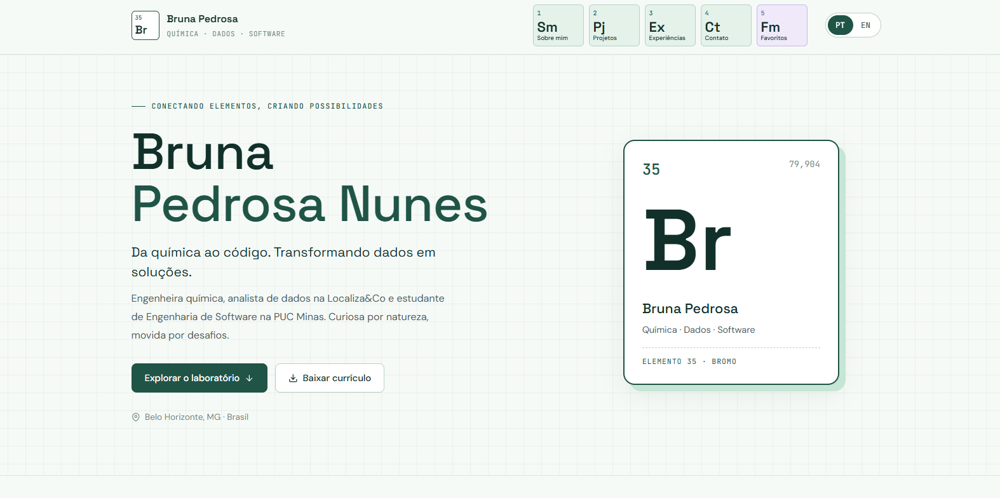      |     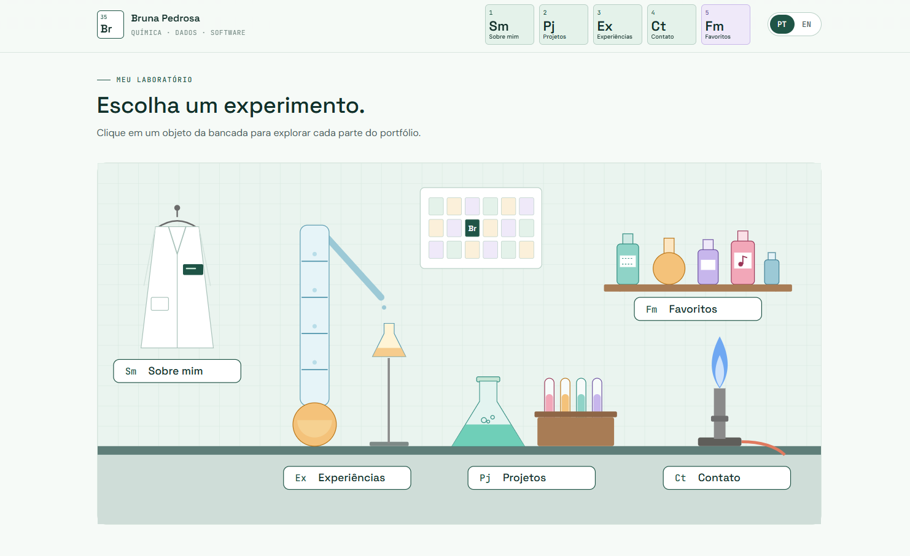      |
|                                         **A reação (fim da página inicial)**                                          |                                               **Sobre mim**                                               |
| 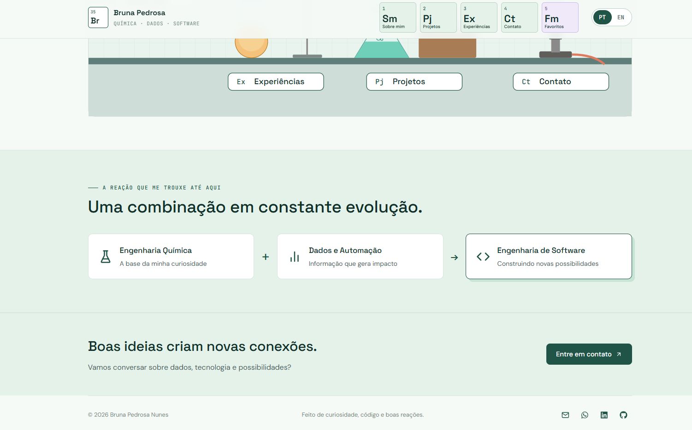 |    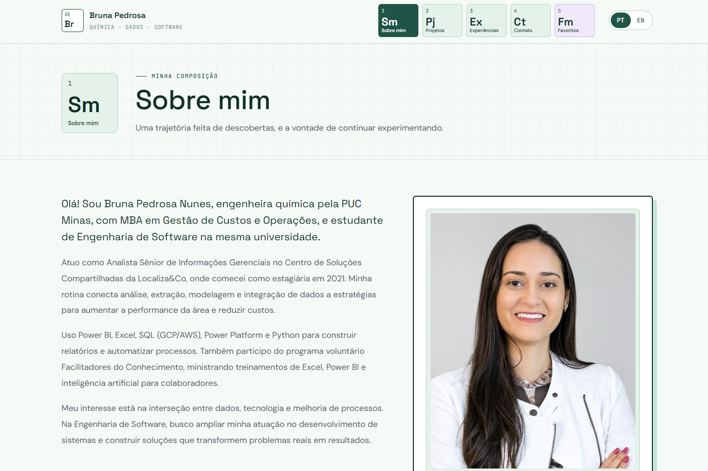     |
|                                             **Projetos (linha do tempo)**                                             |                                             **Experiências**                                              |
|                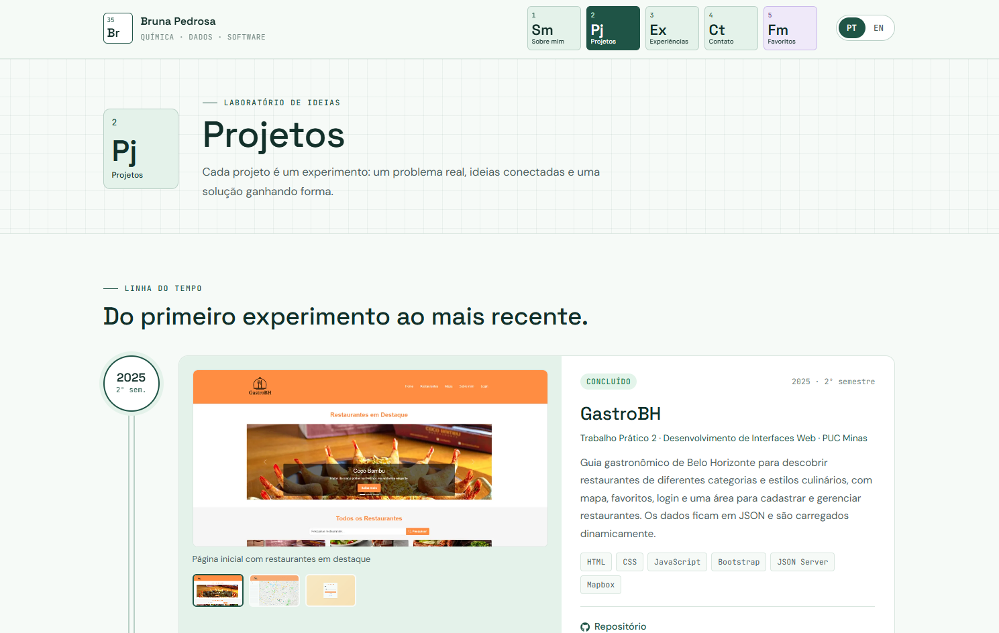                 | 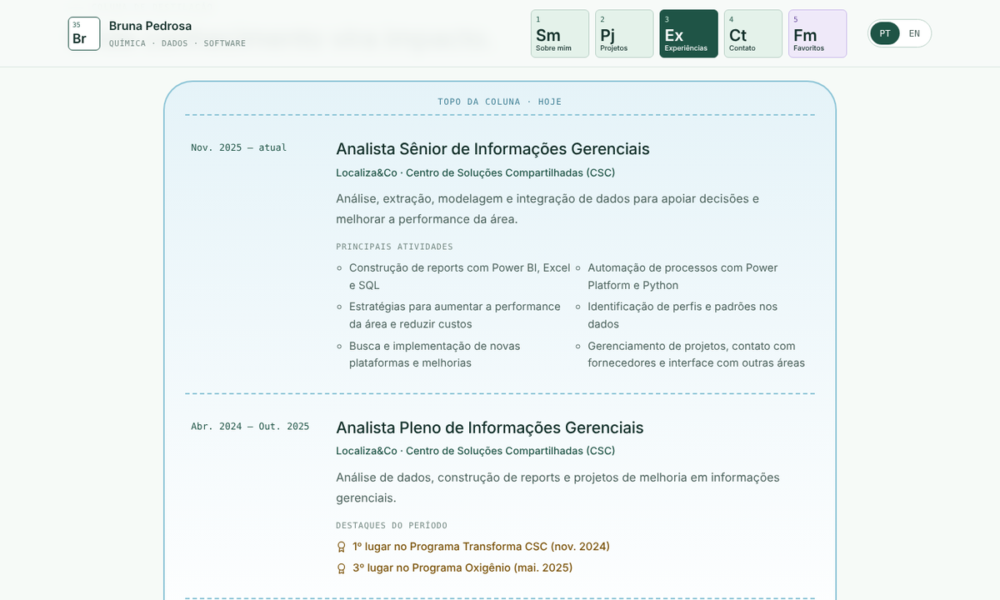  |
|                                                      **Contato**                                                      |                                               **Favoritos**                                               |
|         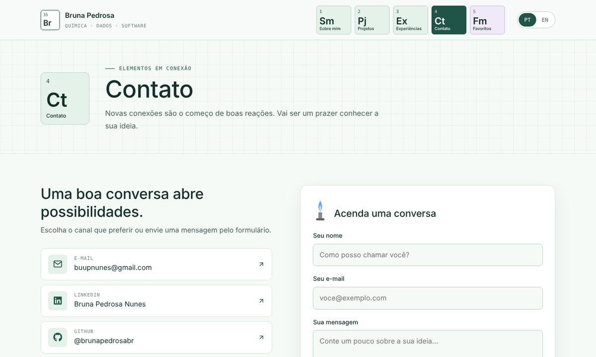          | 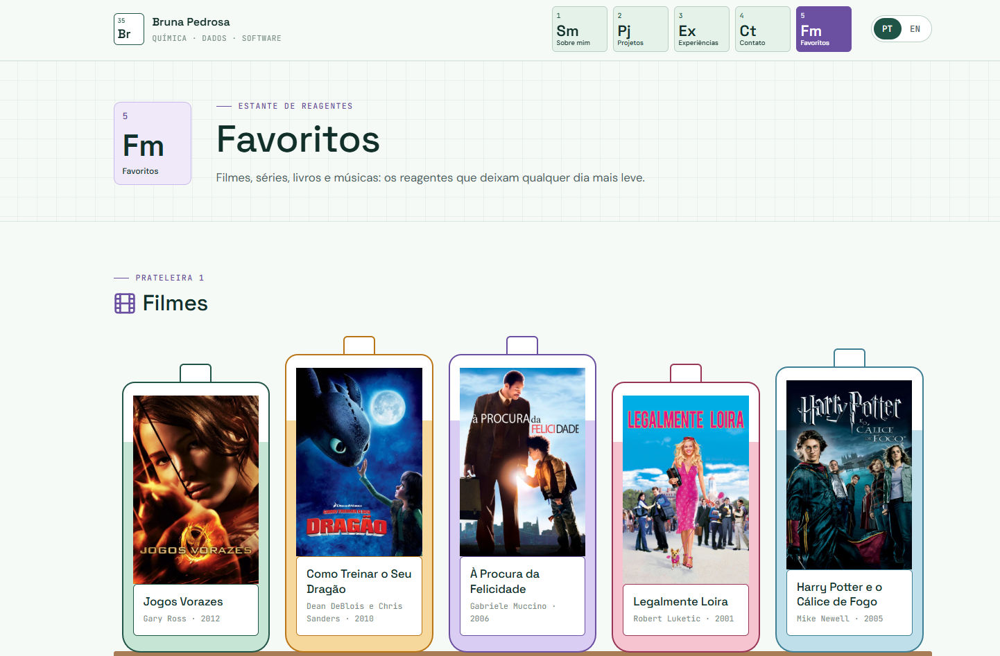 |

### 📱 Versão Mobile

|                                          Início                                           |                                        Projetos                                         |                                        Contato                                        |
| :---------------------------------------------------------------------------------------: | :-------------------------------------------------------------------------------------: | :-----------------------------------------------------------------------------------: |
| 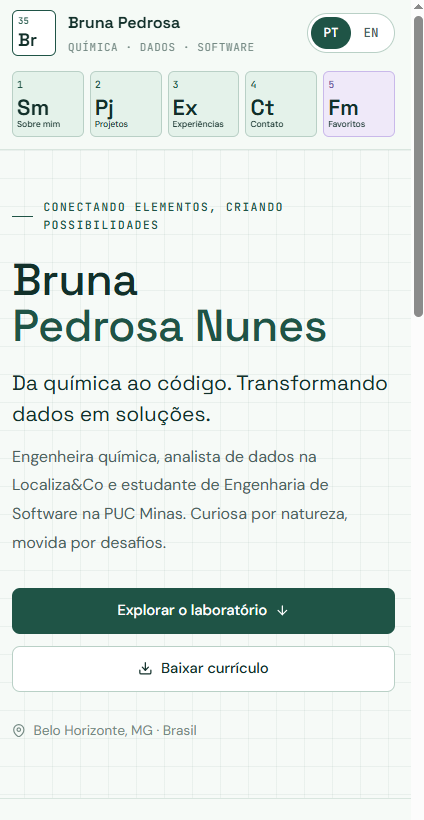 | 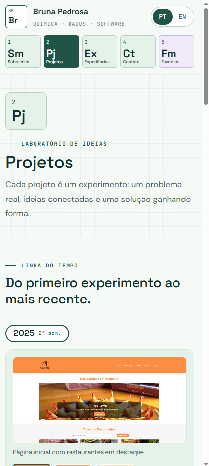 | 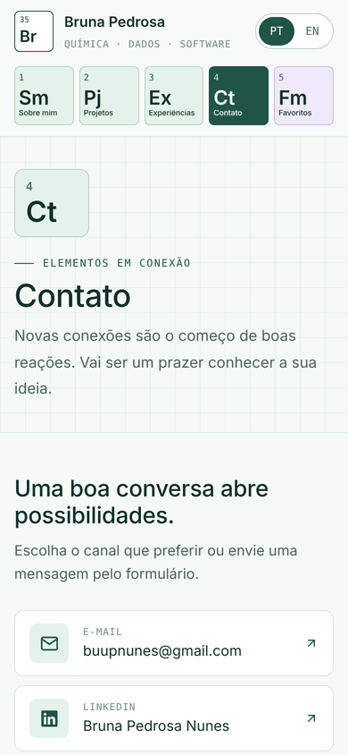 |

### 💻 Exemplo de uso da API

```bash
curl -X POST http://localhost:8080/api/contatos \
     -H "Content-Type: application/json" \
     -d '{"nome":"Maria","email":"maria@exemplo.com","mensagem":"Olá, gostei do seu portfólio!","idioma":"pt"}'
```

**Saída esperada (201 Created):**

```json
{
  "id": 1,
  "nome": "Maria",
  "email": "maria@exemplo.com",
  "mensagem": "Olá, gostei do seu portfólio!",
  "idioma": "pt",
  "criadoEm": "2026-10-10T03:00:00Z"
}
```

Com dados inválidos, a API responde **400** indicando o problema de cada campo (o texto da mensagem segue o idioma do servidor):

```json
{
  "erro": "Dados inválidos",
  "campos": { "email": "must be a well-formed email address" }
}
```

---

## 🧪 Testes

### Back-end (JUnit 5 + MockMvc)

```bash
cd backend
mvn test
```

_Testa o health check, o cadastro de uma mensagem válida, a recusa de dados inválidos e a proteção da listagem._

### Front-end

```bash
cd frontend
npm run lint    # análise estática com Oxlint
npm run build   # checagem de tipos (TypeScript) + build de produção
```

---

## 🔗 Documentações utilizadas

- 📖 [Documentação do **React**](https://react.dev/reference/react)
- 📖 [Guia do **Vite**](https://vite.dev/guide/)
- 📖 [**React Router**](https://reactrouter.com/)
- 📖 [**React Hook Form**](https://react-hook-form.com/)
- 📖 [**EmailJS**: envio pelo navegador](https://www.emailjs.com/docs/sdk/send/)
- 📖 [Documentação do **Spring Boot**](https://docs.spring.io/spring-boot/index.html)
- 📖 [**Supabase**: conexão com o banco](https://supabase.com/docs/guides/database/connecting-to-postgres)
- 📖 [**Vercel**: deploy com Vite](https://vercel.com/docs/frameworks/vite)
- 📖 [**Render**: deploy com Docker](https://render.com/docs/docker)
- 📖 [**Conventional Commits**](https://www.conventionalcommits.org/pt-br/v1.0.0/)

---

## 👥 Autores

| 👤 Nome             | :octocat: GitHub                                                                                                                                                      | 💼 LinkedIn                                                                                                                                                                       | 📤 Gmail                                                                                                                                                      |
| ------------------- | --------------------------------------------------------------------------------------------------------------------------------------------------------------------- | --------------------------------------------------------------------------------------------------------------------------------------------------------------------------------- | ------------------------------------------------------------------------------------------------------------------------------------------------------------- |
| Bruna Pedrosa Nunes | <div align="center"><a href="https://github.com/brunapedrosabr"></a></div> | <div align="center"><a href="https://www.linkedin.com/in/brunapedrosabr/"></a></div> | <div align="center"><a href="mailto:buupnunes@gmail.com"></a></div> |

---

## 🤝 Contribuição

1. Faça um `fork` do projeto.
2. Crie uma branch (`git checkout -b feature/minha-feature`).
3. Faça commit das mudanças seguindo os [Conventional Commits](https://www.conventionalcommits.org/pt-br/v1.0.0/) (`git commit -m 'feat: adiciona nova seção'`).
4. Envie para a branch (`git push origin feature/minha-feature`).
5. Abra um **Pull Request**.

---

## 🙏 Agradecimentos

- [**Engenharia de Software PUC Minas**](https://www.instagram.com/engsoftwarepucminas/) - Pelo apoio institucional e pela estrutura acadêmica.
- [**Prof. Dr. João Paulo Aramuni**](https://github.com/joaopauloaramuni) - Pela proposta do laboratório e pelos ensinamentos em **Desenvolvimento e Integração de Aplicações Web**.

---

## 📄 Licença

Este projeto é distribuído sob a **[Licença MIT](LICENSE)**.

---
